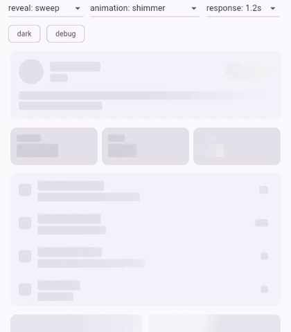
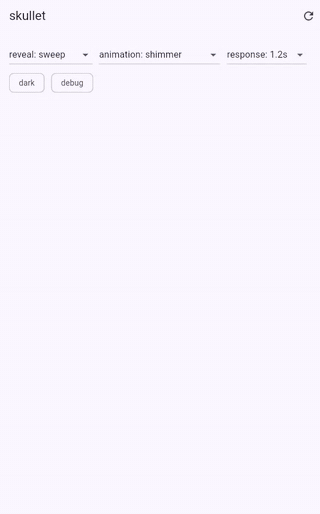
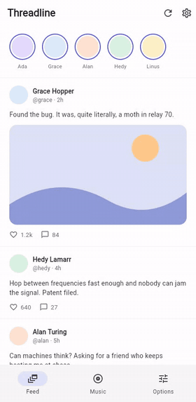
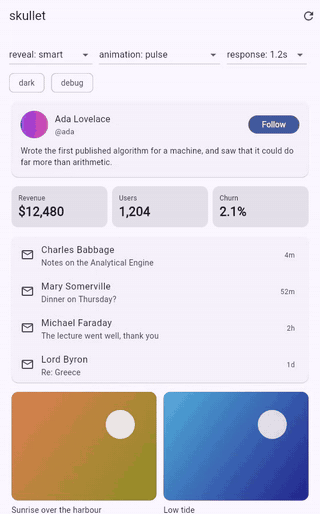
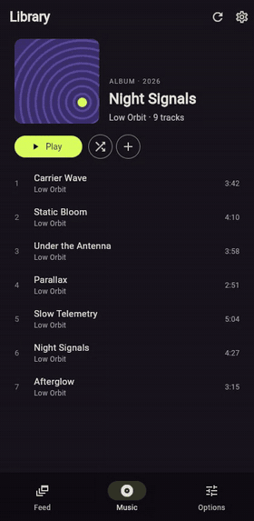
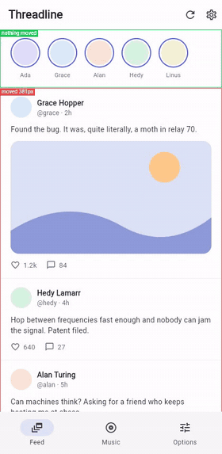

# skullet

Skeletons measured from your real Flutter layout.

Wrap what you would render once your data arrives. While it loads, skullet lays that content out unseen and draws a skeleton over it: a bar for every line of text, a block for every image, icon and control. The skeleton takes exactly the space the content will, so nothing moves when it arrives.

This is an unofficial Flutter port of [skullet](https://github.com/lochie/skullet) by Lochie Axon, which does the same for React, Vue, Svelte and the DOM. It is not affiliated with the original project.



## Gallery

Recorded from the [example app](example/) in Chrome. Each clip reloads the page's data with a 1.2 second delay.

<table>
  <tr>
    <td align="center"><br><b>sweep</b>: one slanted front with a gloss band, shared across cards</td>
    <td align="center"><br><b>smart</b> (default): rows fade in from the top</td>
    <td align="center"><br><b>sequence</b>: piece after piece</td>
  </tr>
  <tr>
    <td align="center"><br><b>pulse</b> instead of shimmer</td>
    <td align="center"><br>Dark colours with a sweep</td>
    <td align="center"><br><b>debug</b>: where each skeleton's shape came from, and whether anything moved</td>
  </tr>
</table>

Images keep their skeleton until they finish loading, as in the photo row of each clip.

## Install

```shell
flutter pub add skullet
```

## Use

Pass your data and build from it. It is loading while `data` is null:

```dart
import 'package:flutter/material.dart';
import 'package:skullet/skullet.dart';

class Profile extends StatelessWidget {
  const Profile({super.key, required this.user});

  final User? user; // null while loading

  @override
  Widget build(BuildContext context) {
    return Skeleton<User>(
      data: user,
      sample: const User(name: 'Sample Name', bio: 'A bio of typical length.'),
      id: 'profile',
      label: 'Loading profile',
      builder: (context, user) => ProfileCard(user: user),
    );
  }
}
```

Your builder only ever receives real data or `sample`; there is no second skeleton widget to write or keep in step.

Or toggle it yourself; the child is measured as it is:

```dart
Skeleton.child(loading: isLoading, child: ProfileCard(user: user))
```

Or hand it a future:

```dart
FutureSkeleton<User>(
  future: api.fetchUser(),
  sample: sampleUser,
  builder: (context, user) => ProfileCard(user: user),
)
```

| `Skeleton` | Type | |
| --- | --- | --- |
| `data` | `T?` | Loading while null; passed to `builder` once set. |
| `builder` | `(BuildContext, T) → Widget` | Builds the content. |
| `sample` | `T?` | Stands in for `data` to draw the first skeleton. |
| `loading` | `bool` | Shows the skeleton even over `data`, say while refetching. |
| `id` | `String?` | Remembers the shape under this key. |
| `label` | `String?` | Read to screen readers while loading. |
| `skeleton` | `Widget?` | Shown while loading instead of the measured skeleton. |
| `error` | `Widget?` | Shown in place of the content when set. |
| `empty`, `emptyMessage` | `bool`, `Widget?` | Shows `emptyMessage` in place of the content. |
| `reveal` | `RevealMode?` | Overrides the provider's reveal. |
| `onReveal` | `VoidCallback?` | Called once content has come in over a skeleton. |

## Where the skeleton's shape comes from

skullet uses the best it has, in this order:

1. The data on screen, when you set `loading` over it.
2. The data last shown under the same `id`, so a reload is exact.
3. The shape remembered under that `id`.
4. Your `sample`.
5. A few generic lines, with a warning in debug builds.

Remembered shapes keep layout, never content. By default they live in memory; to keep them across launches, set `Skullet.store` to your own `ShapeStore` and save `SkeletonShape.toJson()` (it holds only rectangles). Clear them on sign-out:

```dart
forgetShapes();
```

## Provider and theme

```dart
SkulletProvider(
  reveal: RevealMode.smart,
  mode: SkulletMode.system, // or light / dark
  theme: const SkulletTheme(
    light: SkeletonColors(base: Color(0x12000000), highlight: Color(0x99FFFFFF)),
    dark: SkeletonColors(base: Color(0x14FFFFFF), highlight: Color(0x1AFFFFFF)),
    animation: SkeletonAnimation.shimmer, // groupShimmer, pulse, none
    speed: SkeletonSpeed.slow, // shimmer 4s / 2s, pulse 2.4s / 1.2s
    radius: 4, // lines of text; images and chips keep their own
  ),
  debug: false,
  child: MyApp(),
)
```

Every skeleton on screen shares one shimmer, timed by the frame clock and placed by its position on screen, however late it mounts.

## Reveals

How content replaces its skeleton:

- `smart` (default) decides as content lands: at once for a load under 150 ms (a skeleton is held back that long, so a fast load never flashes one) or for someone mid-gesture; a quick crossfade for a refetch; whole for something small; otherwise rows and cards come in top to bottom, smaller text a beat behind, off-screen content at once.
- `together` crossfades the whole skeleton into the content.
- `sequence` brings each piece in where its skeleton was, top to bottom.
- `sweep` uncovers the content behind a slanted front at the shimmer's angle, with a gloss that lifts only the content's text and images. Reveals that land together share one front. It turns into a crossfade for anything over 1.5 screens, or if frames drop.
- `instant` swaps at once.

Under reduced motion (`MediaQuery.disableAnimations`), skeletons hold still and every reveal is instant. If the content turns out taller or shorter than its skeleton, the height eases over 280 ms rather than snapping.

Images never hold a reveal back: each one still loading keeps a skeleton of its own until it has decoded, then fades in. Give images a size (`width` and `height`, or an `AspectRatio`); one that only gets a size on load moves when it does, and a debug warning says so.

## Hints

Measuring gets most layouts right: text, `Image`, `Icon`, buttons, chips, `Card`s, text fields, switches. Where it doesn't, mark the widget:

```dart
SkeletonBlock(child: Logo())          // one block
SkeletonIgnore(child: Badge())        // nothing
SkeletonReplace(                      // measured in its place
  skeleton: SkeletonBox(width: 120, height: 40),
  child: Chart(),
)
```

`SkeletonBox` is a placeholder box that joins the shared shimmer and follows the theme.

## Debugging

Set `debug: true` on the provider. Every skeleton is outlined in blue with where its shape came from; once revealed, green if nothing moved, red with how far the content moved. Debug builds also print a warning when a skeleton and its content differ in height, when an image has no size, and when there is nothing to measure.

## Testing

Under `flutter test`, skeletons hold still and every reveal is instant, so `pumpAndSettle` settles and content is in the tree as soon as its data is. Set `debugSkulletAnimateInTests = true` to test the animations themselves.

While loading, the sample's text is in the tree inside the skeleton (excluded from semantics). Find content by semantics or after the reveal rather than by text during loading.

## Platforms

Pure Dart and Flutter, with no platform code.

| Platform | Status |
| --- | --- |
| Unit and widget tests | Verified on Linux, macOS and Windows in CI: 17 geometry cases ported from skullet, 21 behaviour tests; golden images on Linux |
| Oldest Flutter (3.32.0) | Verified in CI: analyze and tests |
| Web (CanvasKit, Chromium) | Verified in headless Chromium: skeletons, sweep reveal, image skeletons |
| Android, iOS, macOS, Windows, Linux desktop | The example app builds for each in CI; not yet run on devices |

## Limits

- Slivers and lazy lists: only laid-out children can be measured, so a `ListView.builder` skeleton covers what is on screen.
- `CustomPaint`, charts, platform views and SVGs can't be looked into; they are drawn as one block or need a hint.
- Text bars run from the font's ascent to its descent. skullet's cap-height and x-height options are not ported: Flutter doesn't expose those metrics.
- Remembered shapes are keyed by `id` and text scale. A shape from a different width is drawn as remembered until the content is measured again.
- The web version's server rendering, CSP nonce, CSS variables and web component have no Flutter equivalent and are not ported.

## License

MIT. See [LICENSE](LICENSE), which includes the original skullet's copyright notice.
